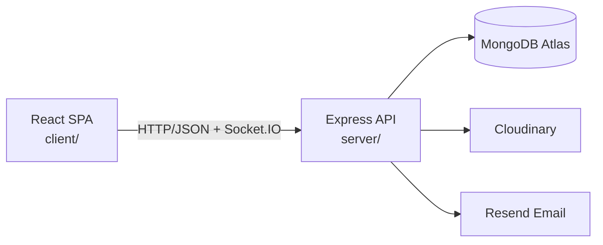
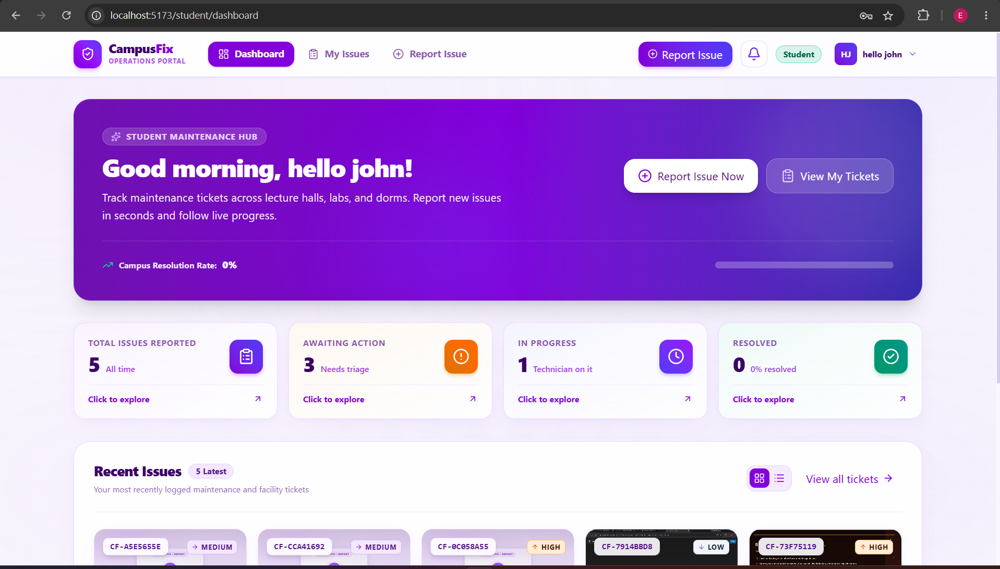
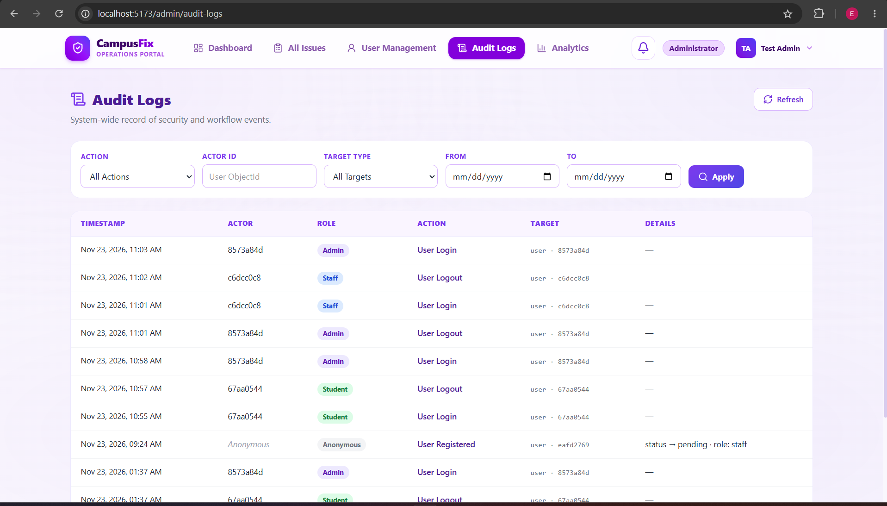

# CampusFix

**A full-stack campus issue-management platform** — students report facility problems, staff resolve them, and admins oversee the entire operation with real-time updates, notifications, audit logging, and analytics.

 

---

## Table of Contents

- [Overview](#overview)
- [Key Features](#key-features)
- [User Roles](#user-roles)
- [Tech Stack](#tech-stack)
- [Architecture](#architecture)
- [Screenshots](#screenshots)
- [Getting Started](#getting-started)
- [Environment Configuration](#environment-configuration)
- [Running the Application](#running-the-application)
- [Testing](#testing)
- [API Documentation](#api-documentation)
- [Security](#security)
- [Real-time System](#real-time-system)
- [Integrations](#integrations)
- [Documentation](#documentation)
- [Known Limitations](#known-limitations)
- [Future Improvements](#future-improvements)

---

## Overview

CampusFix streamlines campus maintenance reporting into a single workflow:

1. A **student** reports an issue — optionally attaching a photo — and receives a tracking ticket ID.
2. An **admin** reviews the report and assigns it to a **staff** member.
3. The **staff** member updates the status through a controlled lifecycle until the issue is resolved.
4. Everyone involved gets **real-time updates**, **persistent notifications**, and **email alerts** — no page refreshes required.

## Key Features

| Feature | Description |
|---|---|
| Role-based access control | Student / Staff / Admin with server-enforced RBAC |
| Issue lifecycle | `reported → assigned → in_progress → resolved/rejected` with full status history |
| Photo uploads | Cloudinary signed uploads + legacy Base64 compatibility |
| Real-time updates | Socket.IO rooms push live changes to every relevant screen |
| Notifications | Persistent in-app notifications + Resend email alerts |
| Audit logging | Append-only activity trail with admin UI and filters |
| Analytics dashboard | 5 live charts: status, priority, category, monthly trends, staff workload |
| Security | httpOnly JWT cookies, CSRF protection, rate limiting, token revocation |

## User Roles

| Role | Registration | Access |
|---|---|---|
| **Student** | Self-service | Report issues, track own issues, receive notifications |
| **Staff** | Self-service → pending approval | Assigned issues only, status updates |
| **Admin** | Seeded / promoted | Full oversight: users, assignments, audit logs, analytics |

## Tech Stack

| Layer | Technology |
|---|---|
| Frontend | React 19, Vite, Tailwind CSS, Recharts, Socket.IO Client |
| Backend | Node.js, Express, Socket.IO, JWT, bcryptjs |
| Database | MongoDB Atlas, Mongoose |
| Media | Cloudinary (signed upload tokens) |
| Email | Resend (HTTPS API, dev-mode fallback) |
| Testing | Node.js test runner — 118 automated tests |

## Architecture

A **modular monolith**: a React SPA talks to a single Express API backed by MongoDB.
The backend follows a strict **Controller → Service → Repository** layering, with
Socket.IO attached to the same HTTP server.



```
CampusFix/
├── client/                  # React + Vite frontend
│   └── src/
│       ├── components/      # shared UI + notifications + admin charts
│       ├── pages/           # auth, student, staff, admin
│       ├── services/        # API client, socket service
│       ├── hooks/           # useRealtime, etc.
│       └── context/         # AuthContext, ToastContext
├── server/                  # Express + Socket.IO backend
│   └── src/
│       ├── controllers/     # HTTP handlers
│       ├── services/        # business logic
│       ├── repositories/    # MongoDB access + aggregations
│       ├── models/          # User, Issue, Notification, AuditLog
│       ├── routes/          # auth, issues, users, admin, audit, notifications
│       ├── middleware/      # auth, CSRF, rate limiting
│       ├── socket/          # Socket.IO server + rooms
│       └── validators/      # request validation
├── docs/                    # full technical documentation
└── README.md
```

## Getting Started

### Prerequisites

- **Node.js** 20+
- **MongoDB** Atlas cluster (or local instance)
- Optional: Cloudinary account (photo uploads), Resend account (email)

### Installation

```powershell
# 1. Backend
cd server
npm install
copy .env.example .env      # then fill in your values

# 2. Frontend
cd client
npm install
copy .env.example .env      # VITE_API_BASE_URL=http://localhost:5000/api
```

### Create the admin account

```powershell
cd server
npm run seed:admin          # uses ADMIN_* vars from .env
```

## Environment Configuration

| Variable | Required | Purpose |
|---|---|---|
| `MONGODB_URI` | ✅ | Database connection string |
| `JWT_SECRET` / `CSRF_SECRET` | ✅ | Token + CSRF signing secrets |
| `CLIENT_ORIGINS` | ✅ | CORS allowlist for API + sockets |
| `CLOUDINARY_*` | optional | Photo upload credentials |
| `RESEND_API_KEY` | optional | Real email delivery (dev-mode fallback without it) |

Full reference: [docs/development/environment-variables.md](docs/development/environment-variables.md)

## Running the Application

```powershell
# Terminal 1 — Backend API + Socket.IO
cd server
npm run dev                 # http://localhost:5000

# Terminal 2 — Frontend
cd client
npm run dev                 # http://localhost:5173 (or next free port)
```

Open `http://localhost:5173` and register a student account to get started.

## Testing

```powershell
cd server
npm test                                        # full suite (118 tests)
node --test --test-concurrency=1 "tests/**/*.test.js"   # sequential (recommended)
npm run format:check

cd client
npm run build
npm run format:check
npm run lint
```

See [docs/testing/testing-guide.md](docs/testing/testing-guide.md) for details and [docs/testing/manual-testing-checklist.md](docs/testing/manual-testing-checklist.md) for manual verification steps.

## API Documentation

Complete endpoint reference: [docs/api/api-reference.md](docs/api/api-reference.md)

## Security

CampusFix implements defense-in-depth:

- 🔐 **httpOnly JWT cookies** — tokens never exposed to JavaScript
- 🛡️ **HMAC-signed CSRF tokens** — all mutating requests verified
- 🔄 **Token-version invalidation** — logout/password change kills all sessions + sockets instantly
- 👥 **RBAC** — role enforced server-side on every route
- 🚦 **Rate limiting** on auth and upload endpoints
- ☁️ **Signed Cloudinary uploads** bound to the user, with orphan cleanup
- 📋 **Secret-free audit logs** — allowlisted metadata only

Details: [docs/security/security-overview.md](docs/security/security-overview.md)

## Real-time System

Socket.IO shares the API's HTTP server. Authenticated sockets join server-assigned
`user:{id}` and `role:{role}` rooms — clients cannot join arbitrary rooms.
Issue, staff, audit, and notification events push live updates; the frontend
refetches authoritative data on every event and on reconnect.

Details: [docs/features/realtime-system.md](docs/features/realtime-system.md)

## Integrations

| Service | Purpose | Without credentials |
|---|---|---|
| **Cloudinary** | Issue photo storage | Uploads unavailable; legacy base64 photos still work |
| **Resend** | Transactional email | Dev mode — emails logged to server console |

## Documentation

| Document | Contents |
|---|---|
| [Architecture](docs/architecture/system-architecture.md) | System design, layers, data flow |
| [API Reference](docs/api/api-reference.md) | All endpoints, auth, parameters |
| [Features](docs/features/overview.md) | Issue mgmt, roles, notifications, realtime, audit, analytics |
| [Security](docs/security/security-overview.md) | Auth, CSRF, RBAC, hardening |
| [Setup](docs/development/setup.md) | Installation & configuration |
| [Environment Variables](docs/development/environment-variables.md) | Every env var explained |
| [Testing Guide](docs/testing/testing-guide.md) | Automated test suite |
| [Manual Checklist](docs/testing/manual-testing-checklist.md) | Step-by-step manual tests |

## Known Limitations

- 📧 Email requires Resend credentials — otherwise logged in dev mode only
- 🖼️ Photo upload requires Cloudinary credentials
- 🔌 Socket.IO is **single-node** — horizontal scaling needs a Redis adapter
- 🔑 No email verification or password-reset flow yet
- ⚠️ Frontend lint has pre-existing errors (codebase-wide React hook patterns)

## Future Improvements

- Redis adapter for multi-instance Socket.IO scaling
- Email verification + password reset
- Push notifications (web/mobile)
- Deployment to a WebSocket-capable platform (decision pending)

---

## Screenshots

Screenshots are stored in `docs/screenshots/` and displayed at a compact width
(~320px) so they remain readable on GitHub. Capture the real screens and save
them using the filenames below, then uncomment the corresponding `` tags.

<!--
<div align="center">







</div>
-->

| File | Screen |
|---|---|
| `login.png` | Login page |
| `student-dashboard.png` | Student dashboard |
| `report-issue.png` | Report issue form |
| `issue-details.png` | Issue details |
| `admin-analytics.png` | Admin analytics charts |
| `admin-issues.png` | Admin issues list |
| `staff-dashboard.png` | Staff dashboard |
| `notifications.png` | Notification bell/dropdown |
| `audit-logs.png` | Admin audit logs |

## License

ISC
